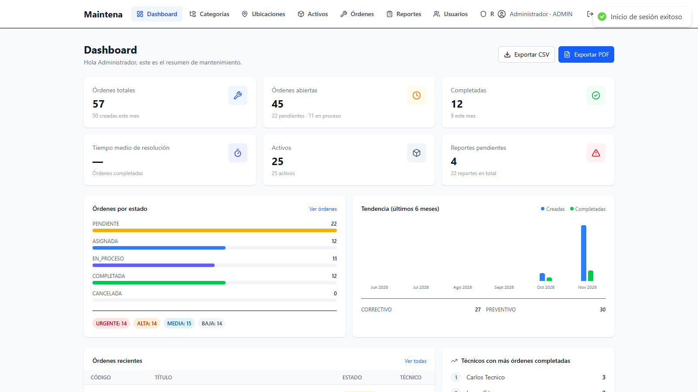
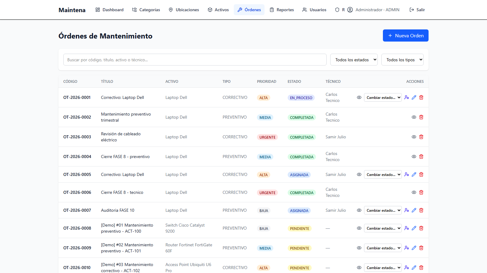
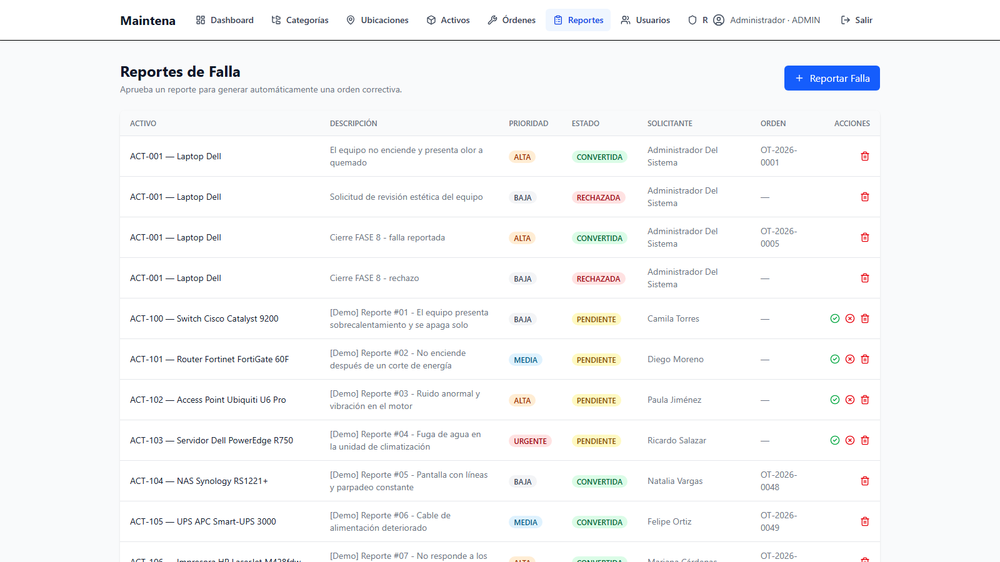
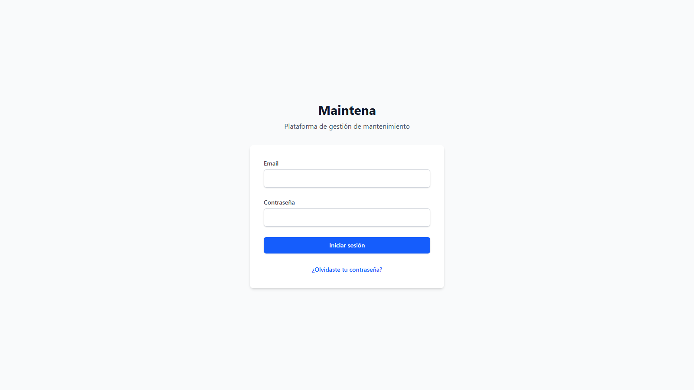

# Maintena

Plataforma web de gestión de mantenimiento y órdenes de trabajo.

## Capturas

| Dashboard | Órdenes de trabajo |
|---|---|
|  |  |

| Reportes de falla | Inicio de sesión |
|---|---|
|  |  |

## Stack

- **Backend:** Java 21, Spring Boot 3.5, Spring Web, Spring Data JPA, Hibernate, MySQL 8, Spring Security (JWT), Spring Validation, Spring Mail, Actuator, Lombok, MapStruct, Springdoc OpenAPI, Flyway, Maven
- **Frontend:** React 19, Vite, React Router, Zustand, Tailwind CSS, Axios, React Hot Toast
- **Calidad:** JUnit 5, Mockito, ArchUnit, Testcontainers (MySQL 8.4), JaCoCo, Spotless
- **Infra:** Docker Compose (MySQL 8.4, backend Spring Boot, frontend Nginx y Mailpit para correo de desarrollo) + GitHub Actions (CI) y Dependabot

## Arquitectura

Backend modular por dominio, con capas `controller → service → repository` y DTOs (las entidades nunca se exponen):

```
com.maintena
├── asset          # Activos
├── audit          # Bitácora de auditoría
├── auth           # Login / JWT
├── category       # Categorías
├── common         # Constantes y respuestas comunes
├── config         # Configuración general
├── dashboard      # Indicadores y KPIs
├── exception      # Excepciones y manejo global
├── health         # Health check
├── location       # Ubicaciones
├── maintenance    # Órdenes de trabajo y reportes de falla
├── notification   # Correos y notificaciones de mantenimiento
├── report         # Exportación de reportes (CSV/PDF)
├── role           # Roles
├── security       # JWT, filtros, UserDetails, usuario actual
└── user           # Usuarios
```

La estructura, las capas y las dependencias permitidas entre módulos están documentadas en [`docs/ARCHITECTURE.md`](docs/ARCHITECTURE.md) y verificadas en cada build con **ArchUnit** (`ArchitectureTest`): controladores sin acceso a repositorios, entidades aisladas de capas superiores, inyección por constructor y un mapa explícito de dependencias entre módulos.

## Puesta en marcha

```bash
# 1. Base de datos y correo de desarrollo
docker compose up -d mysql mailpit

# 2. Backend (http://localhost:8080)
cd backend
mvn spring-boot:run

# 3. Frontend (http://localhost:5173)
cd frontend
npm install
npm run dev
```

Credenciales semilla: `admin@maintena.com` / `Admin123*`

- Swagger UI: http://localhost:8080/swagger-ui.html
- Contrato OpenAPI: http://localhost:8080/api-docs
- Health: http://localhost:8080/actuator/health · http://localhost:8080/api/v1/health
- Info de la aplicación: http://localhost:8080/actuator/info
- Mailpit (correo de desarrollo): http://localhost:8025

Con `MAIL_ENABLED=false` (valor por defecto fuera de Docker) el contenido de cada correo se escribe en el log del backend.

## Pruebas

```bash
cd backend
mvn test      # pruebas unitarias + arquitectura
mvn verify    # además: integración con MySQL real, JaCoCo y Spotless
```

- **131 pruebas** en total: unitarias con JUnit 5 + Mockito, **13 reglas de arquitectura con ArchUnit** y pruebas de integración HTTP contra un **MySQL 8.4 real levantado con Testcontainers** (`AuthFlowIntegrationTest`, `UserDeactivationIntegrationTest`).
- Cobertura medida con JaCoCo (umbral mínimo: 50 % de líneas y 30 % de ramas). El reporte queda en `backend/target/site/jacoco/index.html`; cobertura actual: **60,7 % de líneas** y **48,6 % de ramas**.
- Spotless verifica imports sin usar, espacios finales y saltos de línea en `mvn verify` (`mvn spotless:apply` corrige).
- Las pruebas de integración necesitan Docker en marcha. En Docker Desktop 29+ se fija `api.version=1.44` para Testcontainers en `pom.xml` (el máximo soportado por docker-java 3.4.x y aceptado por el motor).

Casos cubiertos: máquina de estados de órdenes y permisos (incluida la cancelación solo por `ADMIN` y la reapertura con motivo y auditoría), aprobación/rechazo de reportes (incluida la generación de la orden correctiva), comentarios y adjuntos de órdenes (permisos de autor/administrador, validación de tipo y tamaño, limpieza de archivos), borrado protegido de órdenes con reporte y desactivación de usuarios con revocación de sesiones, login y auditoría de accesos, refresh con rotación y revocación, perfil y cambio de contraseña, bloqueo por intentos fallidos, recuperación de contraseña (token hasheado, caducidad, un solo uso, cooldown y revocación de sesiones), envío de correo tolerante a fallos y notificaciones de mantenimiento, validación del filtro JWT (los refresh tokens no sirven como bearer), exportación CSV/PDF, cálculo de KPIs del dashboard, correlación de peticiones y contrato OpenAPI público.

### Pruebas E2E con Playwright

La carpeta `frontend/e2e` contiene 16 pruebas que recorren los flujos de los cuatro roles contra la aplicación real (no usan mocks):

| Suite | Cobertura |
|---|---|
| `admin.spec.js` | Login, dashboard con KPIs, navegación por todos los módulos, creación/edición/eliminación de una categoría, cancelación con confirmación y reapertura de la misma orden (con motivo y registro en auditoría), cierre de sesión y error con credenciales inválidas |
| `tecnico.spec.js` | Menús de administración ocultos, redirección de `/users`, órdenes limitadas a las asignadas (contrastadas con la API), sin opción de cancelar, filtros, búsqueda y detalle con comentarios/adjuntos |
| `supervisor.spec.js` | Menús de operación sin administración, mismo universo de órdenes que el administrador, cambio de estado solo en las asignadas a él y gestión de todos los reportes sin poder eliminarlos |
| `empleado.spec.js` | Menús de administración ocultos, redirección de `/users`, órdenes propias sin acciones de gestión y creación de un reporte de falla |

Requisitos: el stack en marcha (`docker compose up -d`) y los datos de prueba cargados con `scripts/seed-demo.ps1`, porque las pruebas usan los usuarios `demo.*`.

```bash
cd frontend
npm install
npx playwright install chromium   # solo la primera vez
npm run test:e2e                  # ejecución headless
npm run test:e2e:headed           # con navegador visible
npm run test:e2e:report           # abre el reporte HTML
```

- `@playwright/test` con Chromium y `workers: 1`: la suite comparte la misma base de datos y se ejecuta en serie para evitar carreras.
- Las pruebas crean datos temporales (una categoría, un reporte y una orden de mantenimiento) y los eliminan por API al terminar, incluso si alguna falla.
- `E2E_BASE_URL` (por defecto `http://localhost:8081`) y `E2E_API_URL` (por defecto `http://localhost:8080/api/v1`) permiten apuntar a otro entorno.
- En fallo se guardan captura, vídeo y traza en `frontend/test-results/`; el reporte HTML queda en `frontend/playwright-report/`.

### Integración continua

`.github/workflows/ci.yml` ejecuta en cada push a `main`/`master` y en cada pull request:

- **Backend:** JDK 21, `mvn verify` (pruebas, integración con Testcontainers, cobertura y formato) y publicación del reporte JaCoCo como artefacto.
- **Frontend:** Node 22, `npm ci`, `npm run lint` y `npm run build`.

Dependabot (`.github/dependabot.yml`) revisa semanalmente Maven, npm, Docker y GitHub Actions.

## Despliegue con Docker

```bash
# Construir y levantar MySQL + backend + frontend + Mailpit
docker compose up -d --build

# Ver estado y logs
docker compose ps
docker compose logs -f backend
```

| Servicio | URL |
|---|---|
| Frontend (Nginx) | http://localhost:8081 |
| Backend / Swagger | http://localhost:8080 · http://localhost:8080/swagger-ui.html |
| Mailpit (UI / SMTP) | http://localhost:8025 · `localhost:1025` |
| MySQL | `localhost:3306` |

El frontend se compila con `VITE_API_URL=/api/v1` y Nginx hace proxy de `/api/` hacia `backend:8080`, por lo que no hay CORS en producción. El backend usa el perfil `prod` y aplica las migraciones Flyway al arrancar.

Variables opcionales para `docker compose`: `MYSQL_ROOT_PASSWORD`, `MYSQL_DATABASE`, `MYSQL_USER`, `MYSQL_PASSWORD`, `JWT_SECRET`, `JWT_ACCESS_EXPIRATION`, `JWT_REFRESH_EXPIRATION`, `LOGIN_MAX_ATTEMPTS`, `LOGIN_LOCK_MINUTES`, `APP_CORS_ALLOWED_ORIGINS`, `MAIL_ENABLED`, `MAIL_HOST`, `MAIL_PORT`, `MAIL_FROM`, `APP_FRONTEND_URL`, `PASSWORD_RESET_MINUTES`, `PASSWORD_RESET_COOLDOWN`, `ATTACHMENT_MAX_BYTES`, `ATTACHMENT_MAX_SIZE` y `ATTACHMENT_MAX_REQUEST`.

Los adjuntos se guardan en el volumen `maintena_uploads` (montado en `/app/uploads` del backend), de modo que sobreviven a la recreación del contenedor. En local la ruta se controla con `ATTACHMENT_DIR` (por defecto `uploads`).

```bash
# Detener los contenedores (conserva los datos de MySQL)
docker compose down

# Detener y eliminar también el volumen de la base de datos
docker compose down -v
```

## Observabilidad y manejo de errores

- **Actuator** expone únicamente `/actuator/health` y `/actuator/info`, ambos públicos para sondas y monitorización. El healthcheck del contenedor backend consulta `/actuator/health`.
- **Correlación:** cada petición recibe (o reutiliza, si el cliente la envía) la cabecera `X-Correlation-Id`. El valor aparece en la respuesta, en el MDC y en cada línea de log (`[correlationId]`), lo que permite seguir una operación completa entre frontend, backend y base de datos.
- **Errores:** las respuestas de error usan `ProblemDetail` (RFC 9457) con `type`, `title`, `status`, `detail`, `instance` y las propiedades `timestamp`, `error`, `message` y `path`. Se conserva `message` para compatibilidad con el frontend; las validaciones añaden `errors` con el detalle por campo.
- **Logs:** nivel `INFO` para `com.maintena` y patrón con fecha, nivel, correlation id, logger y mensaje. En `dev` se activa SQL de Hibernate; en `prod` no.

```bash
# Comprobar salud y correlación
curl -i http://localhost:8080/actuator/health
curl -i http://localhost:8080/actuator/info
curl -i http://localhost:8080/api/v1/auth/login \
  -H "Content-Type: application/json" -H "X-Correlation-Id: demo-123" \
  -d '{"email":"admin@maintena.com","password":"incorrecta"}'
```

## Endpoints principales

| Módulo | Ruta base |
|---|---|
| Autenticación | `/api/v1/auth` |
| Categorías | `/api/v1/categories` |
| Ubicaciones | `/api/v1/locations` |
| Activos | `/api/v1/assets` |
| Usuarios | `/api/v1/users` |
| Roles | `/api/v1/roles` |
| Órdenes de mantenimiento | `/api/v1/maintenance/orders` |
| Comentarios y adjuntos de órdenes | `/api/v1/maintenance/orders/{orderId}/comments` · `/attachments` |
| Reportes de falla | `/api/v1/maintenance/reports` |
| Dashboard | `/api/v1/dashboard/summary` |
| Exportaciones | `/api/v1/reports/orders/csv` · `/api/v1/reports/orders/pdf` |
| Auditoría | `/api/v1/audit` (solo `ADMIN`) |

### Autenticación y perfil

| Método | Ruta | Descripción |
|---|---|---|
| `POST` | `/api/v1/auth/login` | Inicia sesión y devuelve `accessToken` + `refreshToken` |
| `POST` | `/api/v1/auth/refresh` | Rota el refresh token y emite un par nuevo |
| `POST` | `/api/v1/auth/logout` | Revoca el refresh token indicado (o todas las sesiones si se omite) |
| `GET` | `/api/v1/auth/me` | Perfil del usuario autenticado |
| `PUT` | `/api/v1/auth/me` | Actualiza nombre, apellido y teléfono |
| `POST` | `/api/v1/auth/change-password` | Cambia la contraseña y revoca todas las sesiones |
| `POST` | `/api/v1/auth/forgot-password` | Solicita un enlace de recuperación (siempre responde `204`) |
| `POST` | `/api/v1/auth/reset-password` | Restablece la contraseña con el token del correo |

### Sesión y seguridad

- El **access token** dura 1 hora por defecto (`JWT_ACCESS_EXPIRATION`) y el **refresh token** 24 horas (`JWT_REFRESH_EXPIRATION`).
- Los refresh tokens se persisten en la tabla `refresh_tokens` y se **rotan** en cada renovación: el token usado queda revocado y no puede reutilizarse (responde `401`).
- `logout` revoca el refresh token recibido; si no se envía, revoca todas las sesiones del usuario. `change-password` también revoca todas las sesiones.
- Tras **5 intentos fallidos** de login para un mismo email (`LOGIN_MAX_ATTEMPTS`), la cuenta se bloquea **15 minutos** (`LOGIN_LOCK_MINUTES`) y el backend responde `429 Too Many Requests` con cabecera `Retry-After`.
- El control de intentos vive **en memoria**: es válido para una sola instancia, no persiste entre reinicios y, para varios nodos, requiere un almacén compartido como Redis.
- El frontend renueva la sesión automáticamente con Axios al recibir un `401`, reintenta la petición original y cierra la sesión si el refresh falla.

### Correo y recuperación de contraseña

- La recuperación envía un enlace a `/reset-password?token=...` con un token aleatorio de 32 bytes (URL-safe). En la tabla `password_reset_tokens` solo se guarda su **hash SHA-256**.
- El token caduca a los **30 minutos** (`PASSWORD_RESET_MINUTES`), es de **un solo uso** y solicitar uno nuevo invalida los anteriores.
- Cada email admite **una solicitud por minuto** (`PASSWORD_RESET_COOLDOWN`); el exceso responde `429` con `Retry-After`.
- La respuesta de `forgot-password` es siempre `204`, exista o no el email, para no revelar qué cuentas están registradas.
- Al restablecer la contraseña se revocan todas las sesiones activas del usuario y se registra `PASSWORD_RESET_REQUEST` / `PASSWORD_RESET` en auditoría.
- **Notificaciones de mantenimiento:** al asignar una orden se avisa al técnico y al aprobar o rechazar un reporte se avisa al solicitante. Se publican como eventos y se envían **después del commit** y de forma asíncrona: un fallo de SMTP nunca revierte ni bloquea la operación.
- El envío usa `MailService`, tolerante a fallos. Con `app.mail.enabled=false` el correo se escribe en el log; en Docker se usa Mailpit (`MAIL_ENABLED=true`) y los mensajes se ven en http://localhost:8025.

### Comentarios y adjuntos de órdenes

Cualquier usuario con visibilidad sobre la orden (administradores y técnicos ven todas; el resto solo las que solicitó) puede consultar y agregar comentarios y adjuntos.

| Método | Ruta | Descripción |
|---|---|---|
| `GET` | `/api/v1/maintenance/orders/{orderId}/comments` | Lista los comentarios en orden cronológico |
| `POST` | `/api/v1/maintenance/orders/{orderId}/comments` | Agrega un comentario (máximo 1000 caracteres) |
| `DELETE` | `/api/v1/maintenance/orders/{orderId}/comments/{commentId}` | Elimina un comentario (autor o `ADMIN`) |
| `GET` | `/api/v1/maintenance/orders/{orderId}/attachments` | Lista los adjuntos |
| `POST` | `/api/v1/maintenance/orders/{orderId}/attachments` | Sube un adjunto (`multipart/form-data`, campo `file`) |
| `GET` | `/api/v1/maintenance/orders/{orderId}/attachments/{attachmentId}` | Descarga o visualiza un adjunto (requiere JWT) |
| `DELETE` | `/api/v1/maintenance/orders/{orderId}/attachments/{attachmentId}` | Elimina un adjunto (quien lo subió o `ADMIN`) |

- Solo se aceptan **imágenes PNG, JPG, WEBP o GIF** y **PDF**, con un máximo de **5 MB** (`ATTACHMENT_MAX_BYTES`). El tipo se deduce de la extensión y se contrasta con el declarado; una extensión no permitida responde `400` y un archivo demasiado grande `413`.
- Los archivos se guardan con un **nombre aleatorio UUID** bajo `orders/{orderId}/`, nunca con el nombre del cliente. El nombre original se conserva solo como metadato.
- La descarga está autenticada y aplica la misma visibilidad que la orden (`403` si no corresponde, `404` si el adjunto no existe).
- Al eliminar un adjunto o una orden se borran también los archivos del disco; si el borrado físico falla, la operación de negocio continúa y solo se registra un aviso.
- Los comentarios y adjuntos se auditan con las acciones `COMMENT` y `ATTACH`; el borrado registra `DELETE`.

### Borrado protegido y desactivación

- Una orden que tiene un reporte asociado **no se puede eliminar**: responde `409 Conflict` indicando el reporte. Hay que eliminar primero el reporte; de lo contrario la clave foránea dejaría el historial inconsistente.
- `DELETE /api/v1/users/{id}` **no borra físicamente** al usuario: lo marca como inactivo (`activo=false`), revoca todos sus refresh tokens y conserva sus órdenes, reportes, comentarios y registros de auditoría. Un login posterior responde `401` y el email sigue ocupado.
- Nginx acepta peticiones de hasta **6 MB** en `/api/`; el límite real de cada adjunto (5 MB) lo aplica el backend.

## Módulos implementados

- **Fase 1-4:** base del backend, seguridad JWT, autenticación y manejo de errores
- **Fase 5:** dashboard y reportes (base)
- **Fase 6:** frontend con autenticación, rutas protegidas y layout
- **Fase 7:** maestros — categorías, ubicaciones, activos, usuarios y roles (CRUD completo)
- **Fase 8:** mantenimiento — órdenes de trabajo con transiciones de estado y reportes de falla que generan órdenes correctivas
- **Fase 9:** dashboard con KPIs (órdenes por estado/tipo/prioridad, tiempo medio de resolución, tendencia de 6 meses) y exportación de órdenes a CSV/PDF
- **Fase 10:** auditoría — bitácora de accesos y operaciones (CRUD, asignaciones, cambios de estado, aprobaciones, exportaciones) con filtros y paginación, visible solo para `ADMIN`
- **Fase 11:** pruebas unitarias con JUnit 5 + Mockito y despliegue completo con Docker (backend multi-stage, frontend con Nginx y proxy `/api/`)
- **Fase 12:** autenticación completa — refresh con rotación, logout y revocación de sesiones, perfil editable, cambio de contraseña y bloqueo por intentos fallidos
- **Fase 13:** correo y recuperación de contraseña — enlaces de un solo uso con token hasheado, cooldown, notificaciones de asignación y de reportes aprobados/rechazados vía eventos asíncronos, Mailpit en Docker
- **Fase 14:** comentarios y adjuntos en órdenes de trabajo — notas de seguimiento con permisos de autor/administrador, subida de imágenes y PDF con validación de tipo y tamaño, descarga autenticada y limpieza de archivos al eliminar
- **Fase 15:** calidad y operación — pruebas de integración con Testcontainers/MySQL, cobertura JaCoCo con umbrales, formato Spotless, CI con GitHub Actions, Dependabot, Actuator, correlation id y errores `ProblemDetail`

## Roles

| Rol | Permisos |
|---|---|
| `ADMIN` | Acceso total; crea/edita/elimina maestros y órdenes, cancela y reabre órdenes |
| `SUPERVISOR` | Ve todas las órdenes y reportes; cambia el estado de las órdenes asignadas a él y aprueba/rechaza reportes. No crea, asigna, cancela ni reabre órdenes |
| `TECNICO` | Ve solo las órdenes asignadas a él, cambia su estado (no puede cancelarlas) y gestiona reportes |
| `EMPLEADO` | Reporta fallas y ve sus propios reportes y órdenes |

### Ciclo de vida de una orden

`PENDIENTE → ASIGNADA → EN_PROCESO → COMPLETADA` es el flujo normal; `CANCELADA` se alcanza desde cualquier estado abierto y `COMPLETADA` es terminal. Cancelar exige confirmación y está reservado a `ADMIN`. Una orden cancelada por error puede **reabrirse** (`PATCH /maintenance/orders/{id}/reopen`, solo `ADMIN`) indicando un motivo obligatorio: conserva su código e historial, vuelve a `PENDIENTE` si no tenía técnico o a `ASIGNADA` si lo conserva, y la reapertura queda registrada en auditoría con la acción `REOPEN`. Las órdenes `COMPLETADA` y `CANCELADA` no se pueden editar.

El rol `SUPERVISOR` tiene visibilidad global: ve todas las órdenes y reportes, puede aprobar o rechazar reportes y cambiar el estado de las órdenes que tenga asignadas, pero no puede crear, asignar, cancelar ni reabrir órdenes. Otros roles personalizados se comportan como `EMPLEADO` para la visibilidad de datos: ven sus propias órdenes y reportes, y solo lectura en maestros. Los permisos de escritura siguen reservados a `ADMIN` (maestros y usuarios) y `TECNICO`/`SUPERVISOR` (operación de sus órdenes asignadas). Todos los roles pueden consultar categorías, ubicaciones y activos en modo lectura como referencia para ubicar y clasificar los equipos.

## Datos de prueba masivos

El script `scripts/seed-demo.ps1` carga datos de demostración a través de la API para probar todos los módulos con volumen realista. Es idempotente: se puede ejecutar varias veces y omite lo que ya existe.

```powershell
# Con el backend en marcha (docker compose up -d)
powershell -ExecutionPolicy Bypass -File .\scripts\seed-demo.ps1
```

También se pueden cambiar la URL y las credenciales:

```powershell
.\scripts\seed-demo.ps1 -BaseUrl http://localhost:8080/api/v1 `
  -AdminEmail admin@maintena.com -AdminPassword 'Admin123*'
```

| Módulo | Registros generados |
|---|---|
| Categorías | 12 nuevas (14 en total) |
| Ubicaciones | 12 nuevas con edificio y piso (14 en total) |
| Activos | 24 nuevos `ACT-100`…`ACT-123` (25 en total) |
| Usuarios | 14 nuevos: 5 técnicos, 7 empleados, 1 supervisor y 1 admin |
| Órdenes | 40 nuevas en todos los estados + 10 generadas al aprobar reportes |
| Reportes | 18 nuevos: 4 pendientes, 10 convertidos y 4 rechazados |
| Comentarios | 30 |
| Adjuntos | 14 evidencias PNG y PDF |

Los usuarios nuevos usan la contraseña `Demo123*`:

- `demo.tecnico1@maintena.com` … `demo.tecnico5@maintena.com` (`TECNICO`)
- `demo.empleado1@maintena.com` … `demo.empleado7@maintena.com` (`EMPLEADO`)
- `demo.supervisor@maintena.com` (`SUPERVISOR`)
- `demo.admin@maintena.com` (`ADMIN`)

Las órdenes, reportes, comentarios y adjuntos generados llevan el prefijo `[Demo]` para identificarlos. Para volver al estado inicial se puede recrear el volumen de MySQL con `docker compose down -v`.

## Migraciones Flyway

```
V1  roles, users, refresh_tokens
V2  datos iniciales (roles + admin)
V3  categories, locations, assets
V4  corrección de contraseña del admin
V5  maintenance_orders, maintenance_reports
V6  audit_logs
V7  password_reset_tokens
V8  maintenance_order_comments, maintenance_order_attachments
```
